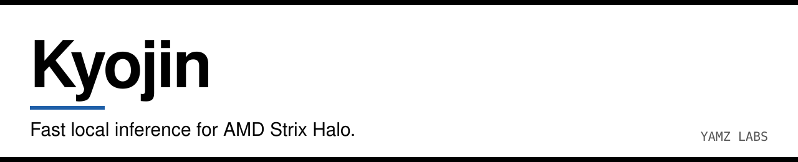
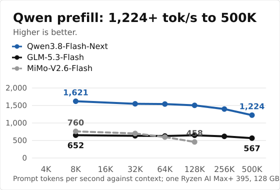
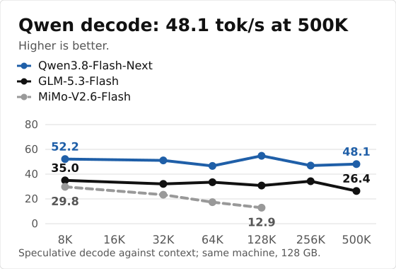
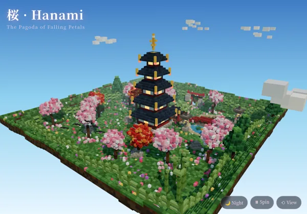

<p align="center"></p>

<p align="center">
Open source. Our own quantised builds of GLM and Qwen. Built on <a href="https://github.com/turboderp-org/exllamav3">ExLlamaV3</a>, with speculative decoding, for 100 GB-class models in 128 GB.</p>

<p align="center">
<a href="LICENSE"></a>


<a href="https://huggingface.co/yamz-labs"></a>
<a href="https://x.com/YamzLabs"></a>
</p>

<table align="center">
<tr><th align="left">Model</th><th>Pack</th><th>Prefill</th><th>Speculative decode</th></tr>
<tr><td><b>Qwen3.8-Flash-Next</b></td><td align="right">95 GB</td><td align="right">1621 at 8K</td><td align="right"><b>47.5 to 73.2</b></td></tr>
<tr><td><b>GLM-5.3-Flash</b></td><td align="right">99.73 GB</td><td align="right">652 at 8K</td><td align="right"><b>27.4 to 36.8</b></td></tr>
<tr><td>MiMo-V2.6-Flash <sub>(1.5)</sub></td><td align="right">105.8 GB</td><td align="right">760 at 8K</td><td align="right">28.9 to 37.0</td></tr>
<tr><td>DeepSeek-V4.1-Flash <sub>(experimental, SSD tier)</sub></td><td align="right">185 GB</td><td align="right">187 to 257 at 8K</td><td align="right">5 to 11 <sub>(plain)</sub></td></tr>
</table>


<p align="center"><sub>Tokens per second on one Ryzen AI Max+ 395 with 128 GB. Prefill at the context shown in each cell, speculative decode across chat, prose and code prompts. DeepSeek-V4.1-Flash is larger than memory: most experts are read from the NVMe (about 3 GB/s), so its prefill is warm/cold and its decode is plain decoding on real sessions; a tool turn of about 2K tokens waits 21 to 35 s for the first token. Details: <a href="doc/DS41.md#speed">doc/DS41.md</a>. Method, sources and full tables: <a href="doc/benchmarks.md">doc/benchmarks.md</a>.</sub></p>

<p align="center">


</p>

<p align="center"><b>Long context: up to 500K tokens</b></p>

<table align="center">
<tr><th align="left">Model</th><th>128K</th><th>256K</th><th>500K</th></tr>
<tr><td><b>Qwen3.8-Flash-Next</b></td><td align="right">1505 / 54.8</td><td align="right">1399 / 46.9</td><td align="right">1224 / 48.1</td></tr>
<tr><td><b>GLM-5.3-Flash</b></td><td align="right">649 / 30.8</td><td align="right">619 / 34.3</td><td align="right">567 / 26.4</td></tr>
</table>

<p align="center"><sub>Prefill / speculative decode, tokens per second, Kyojin 1.5.10 on one Ryzen AI Max+ 395 with 128 GB. One real document read as a growing prompt (500K = 499,712 tokens); prefill as reported by the server. Both models recalled two facts hidden at 40 % and 85 % of a ~500K-token prompt (needle test, Kyojin 1.5.3, 15/10).</sub></p>

500K needs <code>-c 524288</code> at launch. Qwen also needs <code>--cache-bits 8</code>: past 262K it uses the 8-bit cache.

## Made with our models

One prompt each, written by the model running on Kyojin and published as it came out. [Open the gallery](https://yamz-labs.github.io/gallery/).

<table align="center">
<tr><td align="center" width="33%"><a href="https://yamz-labs.github.io/gallery/#pagoda"></a><br><sub><b>Voxel pagoda</b><br>GLM-5.3-Flash</sub></td><td align="center" width="33%"><a href="https://yamz-labs.github.io/gallery/#pagoda"></a><br><sub><b>Voxel pagoda</b><br>Qwen3.8-Flash-Next</sub></td><td align="center" width="33%"><a href="https://yamz-labs.github.io/gallery/#pagoda"></a><br><sub><b>Voxel pagoda</b><br>MiMo-V2.6-Flash</sub></td></tr>
</table>

**Uncensored mode.** Each model has an optional mode that makes it refuse far less. The engine applies it at load and the weights stay untouched: ready-made packs for [GLM-5.3-Flash](https://huggingface.co/yamz-labs/GLM-5.3-Flash-EXL3-Yamz-Uncensored) and [MiMo-V2.6-Flash](https://huggingface.co/yamz-labs/MiMo-V2.6-Flash-MOPD-EXL3-Yamz-Uncensored), and a preset inside the [Qwen3.8-Flash-Next pack](https://huggingface.co/yamz-labs/Qwen3.8-Flash-Next-EXL3-Yamz) that is off by default. How it works: [doc/refusal_hook.md](doc/refusal_hook.md).

These are first versions. Speed, context length and model support keep improving.

## DeepSeek-V4.1-Flash

**Experimental.** A demonstration that a 763B model runs exactly on one 128 GB machine. It is slow and not meant for daily agent use: real decode is about 5 to 11 tokens per second, and a tool turn adding about 2K tokens takes about 20 to 35 seconds before the first token (the SSD floor is about 24 s).

DeepSeek-V4.1-Flash-1017 (763B parameters, about 16B active) runs on one 128 GB machine with an NVMe: the 172 GiB EXL3 pack is larger than memory, so the engine keeps a pool of experts in RAM and reads the others from the SSD, exactly. It uses the model's own DSpark draft stages and the original Engram tables (about 190 GB, downloaded from the DeepSeek repository). Pack: [yamz-labs/DeepSeek-V4.1-Flash-EXL3-Yamz](https://huggingface.co/yamz-labs/DeepSeek-V4.1-Flash-EXL3-Yamz). Setup, SSD tier, Engram and speeds: [doc/DS41.md](doc/DS41.md).

## Contributors

Thank you to everyone who tests Kyojin on their own machine and writes precise reports.

- [@felladrin](https://github.com/felladrin): pull requests for the GLM start-up, the GPU target lookup, the bench tool tests, the troubleshooting page, `--sessions` in the Qwen server and `tools/bench.sh --json`; bug reports, an independent benchmark and issue triage.
- [@MangetsuC](https://github.com/MangetsuC): the GLM image path without solver searches (first image of a new size in seconds) and the dense GEMM tune primer.
- [@nobert](https://github.com/nobert): the Prometheus `/metrics` endpoint, merged for GLM and MiMo.
- [@morrisfamily](https://github.com/morrisfamily): benchmark report on a BOSGAME Beyond-Max.
- [@ChrisC381](https://github.com/ChrisC381): reported the GLM difference between paired jobs.
- [@dturini12](https://github.com/dturini12): reported streaming without `finish_reason`; fixed and confirmed.
- [@mostlygeek](https://github.com/mostlygeek): proposal for a container setup.

## Quickstart

Install ROCm torch and build once ([doc/install.md](doc/install.md)), then:

```bash
git clone https://github.com/Yamz-Labs/kyojin && cd kyojin
hf download yamz-labs/Qwen3.8-Flash-Next-EXL3-Yamz --local-dir ./qwen-pack
python tools/qwen/serve.py --model ./qwen-pack --port 8000 -c 131072
```

The server speaks the OpenAI API on port 8000. GLM and MiMo commands: [doc/models.md](doc/models.md).

## Read more

- [Install and first launch](doc/install.md): requirements, build, per-shell setup, first-launch tuning, [system settings for full speed](doc/install.md#system-settings-for-full-speed)
- [Models](doc/models.md): Qwen, GLM and MiMo weights, serve commands, options
- [Benchmarks](doc/benchmarks.md): how the figures are measured, where each comes from, full tables, share yours with `tools/bench.sh`
- [Troubleshooting](doc/troubleshooting.md), [refusal hook](doc/refusal_hook.md), [development](doc/development.md), [credits and licence](doc/credits.md)

Reports and pull requests are welcome: see [CONTRIBUTING.md](CONTRIBUTING.md). Kernel notes: [README.strix-halo.md](README.strix-halo.md). Upstream guide: [README.upstream.md](README.upstream.md).

MIT licence. Built on [ExLlamaV3](https://github.com/turboderp-org/exllamav3) by turboderp, with the first AMD ports by [vcruz305](https://github.com/vcruz305/exllamav3-amd) and [sdougbrown](https://github.com/sdougbrown/exllamav3): [full credits](doc/credits.md). News: [@YamzLabs on X](https://x.com/YamzLabs).
