<p align="center">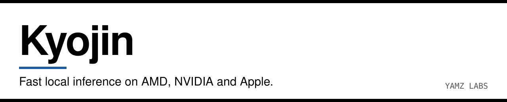</p>

<p align="center">
<b>Run 100 GB-class AI models on one desktop machine.</b><br>Open source. OpenAI API. Built on <a href="https://github.com/turboderp-org/exllamav3">ExLlamaV3</a>.</p>

<p align="center">
<a href="LICENSE"></a>


<a href="https://huggingface.co/yamz-labs"></a>
<a href="https://x.com/YamzLabs"></a>
</p>

<table align="center">
<tr><td align="center" width="25%"><a href="https://huggingface.co/yamz-labs/GLM-5.3-Flash-EXL3-Yamz"><picture><source media="(prefers-color-scheme: dark)" srcset="doc/img/home/card-glm-dark.svg">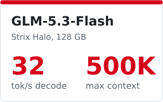</picture></a></td><td align="center" width="25%"><a href="https://huggingface.co/yamz-labs/Qwen3.8-Flash-Next-EXL3-Yamz"><picture><source media="(prefers-color-scheme: dark)" srcset="doc/img/home/card-flash-next-dark.svg">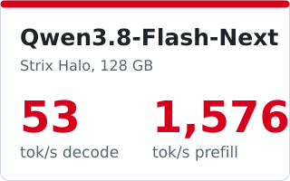</picture></a></td><td align="center" width="25%"><a href="https://huggingface.co/turboderp/Qwen3.8-27B-exl3/tree/SC_4.00bpw_H5_V6"><picture><source media="(prefers-color-scheme: dark)" srcset="doc/img/home/card-qwen27-dark.svg">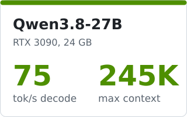</picture></a></td><td align="center" width="25%"><a href="https://huggingface.co/yamz-labs/DeepSeek-V4.1-Flash-EXL3-Yamz"><picture><source media="(prefers-color-scheme: dark)" srcset="doc/img/home/card-ds41-dark.svg">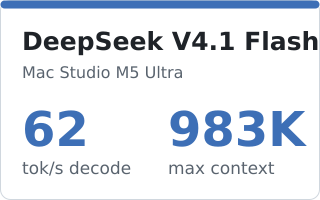</picture></a></td></tr>
</table>

<p align="center"><sub>Decode and prefill tok/s at 8K (RTX: 5K), served. Kyojin 1.8.10 on Strix Halo, 1.8.9 on RTX and Mac.</sub></p>

## Quick start

Strix Halo (AMD): install ROCm torch and build once ([doc/install.md](doc/install.md)), then GLM-5.3-Flash:

```bash
git clone https://github.com/Yamz-Labs/kyojin && cd kyojin
hf download yamz-labs/GLM-5.3-Flash-EXL3-Yamz --local-dir ./glm-pack
python tools/glm/serve.py --model ./glm-pack --port 8000 -c 131072 --num-draft 2
```

RTX 3090 (NVIDIA): build for CUDA once ([tools/cuda/README.md](tools/cuda/README.md)), then Qwen3.8-27B with 245K of context (the served settings, one session), with turboderp's 4.0 bpw pack:

```bash
hf download turboderp/Qwen3.8-27B-exl3 --revision SC_4.00bpw_H5_V6 --local-dir ./qwen27-pack
python tools/qwen/serve.py --model ./qwen27-pack -c 245760 --k-bits 6 --v-bits 6 --draft-policy mix
```

Mac Studio (Apple): follow the [kyojin-mac](https://github.com/Yamz-Labs/kyojin-mac#install) install, then DeepSeek V4.1 Flash:

```bash
hf download yamz-labs/DeepSeek-V4.1-Flash-EXL3-Yamz --local-dir ./ds41-pack
python -m kyojin_mlx.serve.server ./ds41-pack --sessions 4 --ctx 32768 --port 8080
```

Every server speaks the OpenAI API. More commands: [doc/models.md](doc/models.md).

## Speed by context

Tokens per second against context length (log scale), served through the real server with real text. Each chart says its machine, Kyojin version and date. Higher is better.

**Strix Halo (AMD), GLM-5.3-Flash and Qwen3.8-Flash-Next**

<table>
<tr><td width="50%"><picture><source media="(prefers-color-scheme: dark)" srcset="doc/img/home/decode-strix-dark.svg">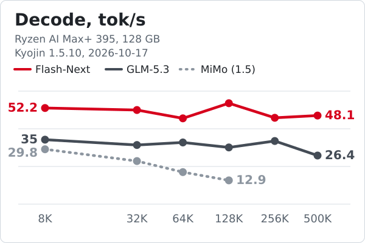</picture></td><td width="50%"><picture><source media="(prefers-color-scheme: dark)" srcset="doc/img/home/prefill-strix-dark.svg">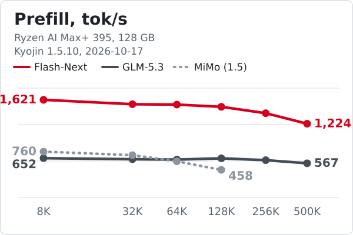</picture></td></tr>
</table>

**RTX 3090 (NVIDIA), Qwen3.8-27B**

<table>
<tr><td width="50%"><picture><source media="(prefers-color-scheme: dark)" srcset="doc/img/home/decode-rtx-dark.svg">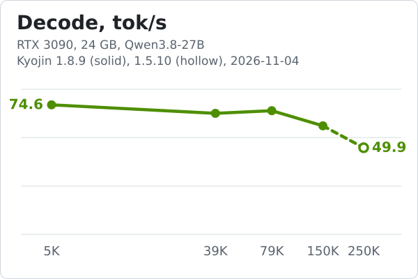</picture></td><td width="50%"><picture><source media="(prefers-color-scheme: dark)" srcset="doc/img/home/prefill-rtx-dark.svg">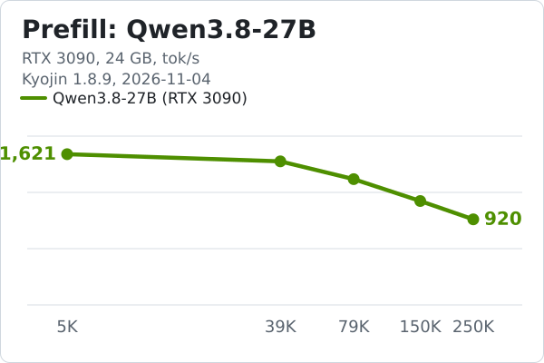</picture></td></tr>
</table>

**Mac Studio (Apple), DeepSeek V4.1 Flash**

<table>
<tr><td width="50%"><picture><source media="(prefers-color-scheme: dark)" srcset="doc/img/home/decode-mac-dark.svg">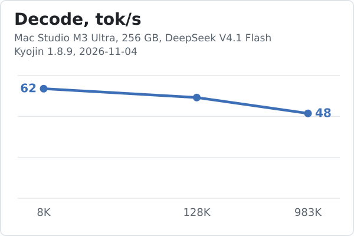</picture></td><td width="50%"><picture><source media="(prefers-color-scheme: dark)" srcset="doc/img/home/prefill-mac-dark.svg">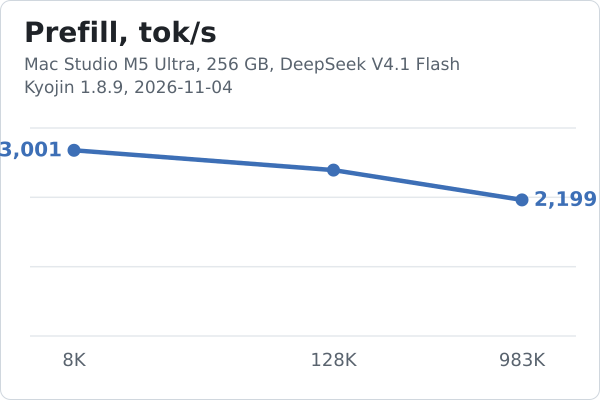</picture></td></tr>
</table>

## What is inside

- Speculative decoding, on by default; it returns the same tokens as plain decoding.
- Long context: up to 983K tokens (DeepSeek V4.1 Flash on a Mac Studio), 500K on GLM-5.3-Flash.
- Image input on Qwen3.8-27B.
- Optional uncensored mode: ready-made packs for [GLM-5.3-Flash](https://huggingface.co/yamz-labs/GLM-5.3-Flash-EXL3-Yamz-Uncensored) and [MiMo-V2.6-Flash](https://huggingface.co/yamz-labs/MiMo-V2.6-Flash-MOPD-EXL3-Yamz-Uncensored), and a preset in the [Qwen3.8-Flash-Next pack](https://huggingface.co/yamz-labs/Qwen3.8-Flash-Next-EXL3-Yamz), off by default. How it works: [doc/refusal_hook.md](doc/refusal_hook.md).

## Made with our models

One prompt each, written by the model running on Kyojin and published as it came out. [Open the gallery](https://yamz-labs.github.io/gallery/).

<table align="center">
<tr><td align="center" width="33%"><a href="https://yamz-labs.github.io/gallery/#pagoda">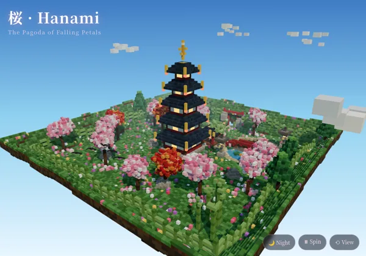</a><br><sub><b>Voxel pagoda</b><br>GLM-5.3-Flash</sub></td><td align="center" width="33%"><a href="https://yamz-labs.github.io/gallery/#pagoda"></a><br><sub><b>Voxel pagoda</b><br>Qwen3.8-Flash-Next</sub></td><td align="center" width="33%"><a href="https://yamz-labs.github.io/gallery/#pagoda">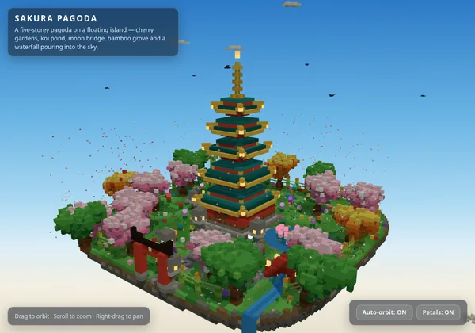</a><br><sub><b>Voxel pagoda</b><br>MiMo-V2.6-Flash</sub></td></tr>
</table>

## Models

All packs are EXL3 on Hugging Face: ours on [yamz-labs](https://huggingface.co/yamz-labs), Qwen3.8-27B from [turboderp](https://huggingface.co/turboderp/Qwen3.8-27B-exl3). Serve commands: [doc/models.md](doc/models.md).

| Pack | Machine | Size |
|---|---|---|
| [GLM-5.3-Flash](https://huggingface.co/yamz-labs/GLM-5.3-Flash-EXL3-Yamz) | Strix Halo | 100.1 GB |
| [Qwen3.8-Flash-Next](https://huggingface.co/yamz-labs/Qwen3.8-Flash-Next-EXL3-Yamz) | Strix Halo | 95.4 GB |
| [Qwen3.8-27B-exl3](https://huggingface.co/turboderp/Qwen3.8-27B-exl3/tree/SC_4.00bpw_H5_V6) (turboderp) | RTX 3090 | 15 GiB |
| [DeepSeek V4.1 Flash](https://huggingface.co/yamz-labs/DeepSeek-V4.1-Flash-EXL3-Yamz) | Mac Studio, Strix Halo (SSD tier) | 184.7 GB |
| [GLM-5.3-Flash, uncensored](https://huggingface.co/yamz-labs/GLM-5.3-Flash-EXL3-Yamz-Uncensored) | Strix Halo | 100.1 GB |
| [MiMo-V2.6-Flash-MOPD](https://huggingface.co/yamz-labs/MiMo-V2.6-Flash-MOPD-EXL3-Yamz) | Strix Halo | 105.0 GB |
| [MiMo-V2.6-Flash-MOPD, uncensored](https://huggingface.co/yamz-labs/MiMo-V2.6-Flash-MOPD-EXL3-Yamz-Uncensored) | Strix Halo | 105.0 GB |
| [Flint-40B-A2.5B](https://huggingface.co/yamz-labs/Flint-40B-A2.5B-EXL3-Yamz) | RTX 3090 | 17.9 GB |
| [Nanbeige4.3-33B](https://huggingface.co/yamz-labs/Nanbeige4.3-33B-EXL3-Yamz) | RTX 3090 | 18.7 GB |

## Contributors

Thank you to everyone who tests Kyojin on their own machine and writes precise reports.

- [@felladrin](https://github.com/felladrin): pull requests for the GLM start-up, the GPU target lookup, the bench tool tests, the troubleshooting page, `--sessions` in the Qwen server and `tools/bench.sh --json`; bug reports, an independent benchmark and issue triage.
- [@MangetsuC](https://github.com/MangetsuC): the GLM image path without solver searches (first image of a new size in seconds) and the dense GEMM tune primer.
- [@nobert](https://github.com/nobert): the Prometheus `/metrics` endpoint, merged for GLM and MiMo.
- [@morrisfamily](https://github.com/morrisfamily): benchmark report on a BOSGAME Beyond-Max.
- [@ChrisC381](https://github.com/ChrisC381): reported the GLM difference between paired jobs.
- [@dturini12](https://github.com/dturini12): reported streaming without `finish_reason`; fixed and confirmed.
- [@mostlygeek](https://github.com/mostlygeek): proposal for a container setup.
- [@kamjin3086](https://github.com/kamjin3086): benchmark of Kyojin 1.6 against another engine and the report of a host freeze at start-up; both led to fixes in 1.7.

## Read more

- [Install and first launch](doc/install.md): requirements, build, per-shell setup, first-launch tuning, [system settings for full speed](doc/install.md#system-settings-for-full-speed)
- [Strix Halo](doc/strix.md), [RTX](doc/rtx.md) and [Mac](https://github.com/Yamz-Labs/kyojin-mac) pages
- [Models](doc/models.md): weights, serve commands, options
- [Benchmarks](doc/benchmarks.md): how the figures are measured, where each comes from, full tables, share yours with `tools/bench.sh`
- [Troubleshooting](doc/troubleshooting.md), [refusal hook](doc/refusal_hook.md), [development](doc/development.md), [credits and licence](doc/credits.md)

Reports and pull requests are welcome: see [CONTRIBUTING.md](CONTRIBUTING.md). Kernel notes: [doc/strix-halo.md](doc/strix-halo.md). Upstream guide: [doc/upstream.md](doc/upstream.md).

MIT licence. Built on [ExLlamaV3](https://github.com/turboderp-org/exllamav3) by turboderp, with the first AMD ports by [vcruz305](https://github.com/vcruz305/exllamav3-amd) and [sdougbrown](https://github.com/sdougbrown/exllamav3): [full credits](doc/credits.md). News: [@YamzLabs on X](https://x.com/YamzLabs).
