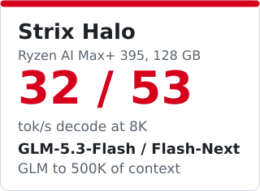
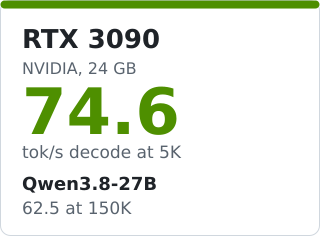
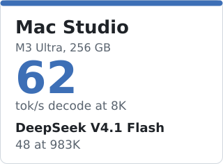
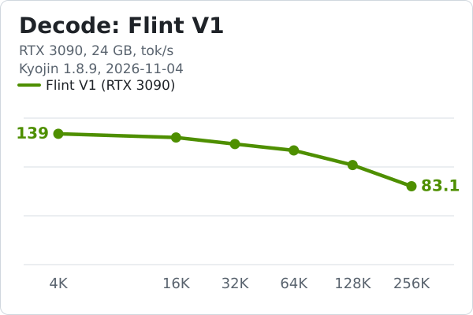
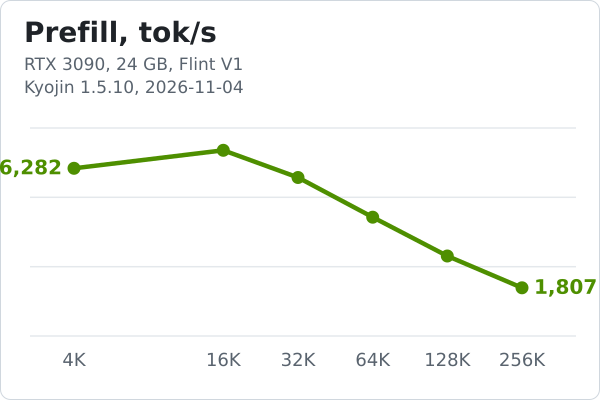
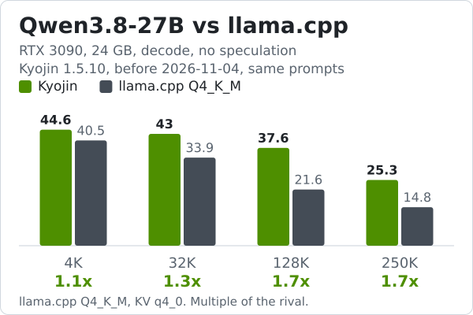
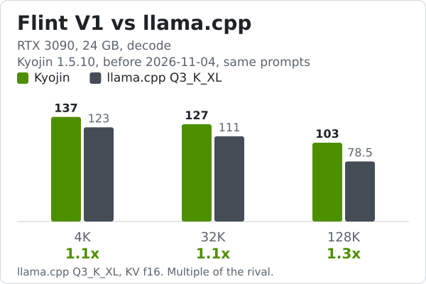
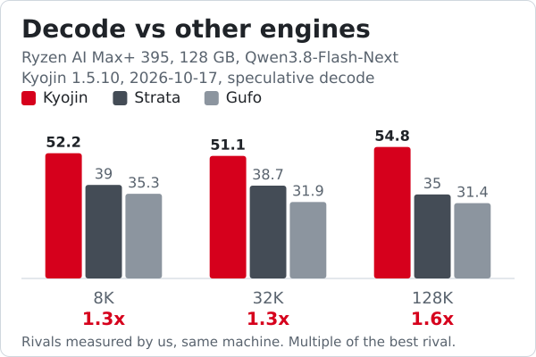
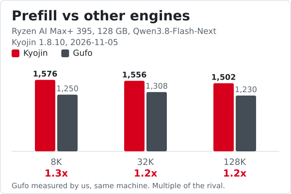

<p align="center"></p>

<p align="center">
Open source. Our own quantised builds of GLM, Qwen, MiMo, DeepSeek, Flint and Nanbeige. Built on <a href="https://github.com/turboderp-org/exllamav3">ExLlamaV3</a>, with speculative decoding, for 100 GB-class models in 128 GB and 30 B-class models in 24 GB.</p>

<p align="center">
<a href="LICENSE"></a>


<a href="https://huggingface.co/yamz-labs"></a>
<a href="https://x.com/YamzLabs"></a>
</p>

**Run 100 GB-class AI models on one desktop machine, with up to 500K tokens of context.** Free, open source, and it speaks the OpenAI API, so your tools just work.

<table align="center">
<tr><td align="center" width="33%"><a href="#strix-halo-amd"><picture><source media="(prefers-color-scheme: dark)" srcset="doc/img/home/card-strix-dark.svg"></picture></a></td><td align="center" width="33%"><a href="#rtx-nvidia"><picture><source media="(prefers-color-scheme: dark)" srcset="doc/img/home/card-rtx-dark.svg"></picture></a></td><td align="center" width="33%"><a href="#mac-apple-silicon"><picture><source media="(prefers-color-scheme: dark)" srcset="doc/img/home/card-mac-dark.svg"></picture></a></td></tr>
</table>

## What you get

| Your machine | Model | Speed | In plain words |
|---|---|---|---|
| **Strix Halo** (AMD, 128 GB) | Qwen3.8-Flash-Next | 53.2 tok/s writing, 1576 tok/s reading, at 8K | Writes about 8 times faster than you read. An 8K-token document is read in about 6 seconds. |
| **RTX 3090** (NVIDIA, 24 GB) | Qwen3.8-27B | 74.6 tok/s writing, 1621 tok/s reading, at 5K | Writes about 11 times faster than you read. 262K tokens of context on one 24 GB card. |
| **Mac Studio** (Apple, 256 GB) | DeepSeek V4.1 Flash | 62 tok/s writing, 3001 tok/s reading, at 8K | Writes about 9 times faster than you read, and keeps 983K tokens of context. |

"tok/s" is tokens per second (a token is about three quarters of a word). Reading speed is about 7 tok/s. Measured through the real server with real text.

## Try it in 3 lines

```bash
git clone https://github.com/Yamz-Labs/kyojin && cd kyojin
hf download yamz-labs/Qwen3.8-Flash-Next-EXL3-Yamz --local-dir ./qwen-pack
python tools/qwen/serve.py --model ./qwen-pack --port 8000 -c 131072
```

That is the Strix Halo command. RTX and Mac commands, and the one-time build: [Quickstart](#quickstart).

## Speed by context

Tokens per second against context length (log scale), served through the real server with real text. Each chart says its machine, Kyojin version and date. Higher is better.

**Strix Halo (AMD)**

<table>
<tr><td width="50%"><picture><source media="(prefers-color-scheme: dark)" srcset="doc/img/home/decode-strix-dark.svg"></picture></td><td width="50%"><picture><source media="(prefers-color-scheme: dark)" srcset="doc/img/home/prefill-strix-dark.svg"></picture></td></tr>
</table>

**RTX 3090 (NVIDIA)**

<table>
<tr><td width="50%"><picture><source media="(prefers-color-scheme: dark)" srcset="doc/img/home/decode-rtx-dark.svg"></picture></td><td width="50%"><picture><source media="(prefers-color-scheme: dark)" srcset="doc/img/home/prefill-rtx-dark.svg"></picture></td></tr>
</table>

<table>
<tr><td width="50%"><picture><source media="(prefers-color-scheme: dark)" srcset="doc/img/home/decode-rtx-flint-dark.svg"></picture></td><td width="50%"><picture><source media="(prefers-color-scheme: dark)" srcset="doc/img/home/prefill-rtx-flint-dark.svg"></picture></td></tr>
</table>

**Mac Studio (Apple)**

<table>
<tr><td width="50%"><picture><source media="(prefers-color-scheme: dark)" srcset="doc/img/home/decode-mac-dark.svg"></picture></td><td width="50%"><picture><source media="(prefers-color-scheme: dark)" srcset="doc/img/home/prefill-mac-dark.svg"></picture></td></tr>
</table>

## Details

Everything below is for people who want the numbers, the comparison with other engines, the model list and the full install.

## Against other engines

Same machine, same prompts. The number under each group is Kyojin divided by the best rival.

<table>
<tr><td width="50%"><picture><source media="(prefers-color-scheme: dark)" srcset="doc/img/home/duel-rtx-qwen27-dark.svg"></picture></td><td width="50%"><picture><source media="(prefers-color-scheme: dark)" srcset="doc/img/home/duel-rtx-flint-dark.svg"></picture></td></tr>
</table>

<table>
<tr><td width="50%"><picture><source media="(prefers-color-scheme: dark)" srcset="doc/img/home/duel-strix-decode-dark.svg"></picture></td><td width="50%"><picture><source media="(prefers-color-scheme: dark)" srcset="doc/img/home/duel-strix-prefill-dark.svg"></picture></td></tr>
</table>

llama.cpp prefills Qwen3.8-27B 10 to 19 % faster up to 32K ([details](doc/rtx.md)). Rival figures on Strix Halo are ones we measured ([method and fidelity](doc/strix.md)).

## All numbers

<details>
<summary>Summary table</summary>

| Machine | Best model | Prefill | Decode | Kyojin | Date |
|---|---|---|---|---|---|
| [Strix Halo](#strix-halo-amd), Ryzen AI Max+ 395, 128 GB | Qwen3.8-Flash-Next | 1576 at 8K | 53.2 at 8K | 1.8.10 | 2026-11-05 |
| [RTX 3090](#rtx-nvidia), 24 GB | Qwen3.8-27B | 1621 at 5K | 74.6 at 5K | 1.8.9 | 2026-11-04 |
| [RTX 3090](#rtx-nvidia), 24 GB | Flint V1 | 6930 at 4K | 138.7 at 4K | 1.8.9 | 2026-11-04 |
| [Mac Studio](#mac-apple-silicon), M3 Ultra, 256 GB | DeepSeek V4.1 Flash | 3001 at 8K | 62 at 8K | 1.8.9 | 2026-11-04 |

Decode on Strix Halo and RTX uses speculative decoding. Full tables and method are on the platform pages: [Strix Halo](doc/strix.md), [RTX](doc/rtx.md), [Benchmarks](doc/benchmarks.md).

</details>

## Strix Halo (AMD)

One Ryzen AI Max+ 395 with 128 GB runs 100 GB-class models: Qwen3.8-Flash-Next at 1480 tok/s prefill (8K) and 47.5 to 73.2 tok/s decode, GLM-5.3-Flash at 652 prefill and 27.4 to 36.8 decode (Kyojin 1.5.10, 2026-10-17; Flash-Next prefill on 1.8.9). Long context goes up to 500K tokens. DeepSeek-V4.1-Flash (763B) runs from the SSD, slowly.

Tables, charts, quickstart and DeepSeek: [doc/strix.md](doc/strix.md). Install: [doc/install.md](doc/install.md).

## RTX (NVIDIA)

One RTX 3090 with 24 GB runs Qwen3.8-27B (1.8.9: 74.6 tok/s decode and 1621 prefill at 5K, 62.5 and 1118 at 150K) and Flint V1 (up to 262144 tokens of context with a 6-bit KV cache). Build: [tools/cuda/README.md](tools/cuda/README.md).

Tables, engine comparison and commands: [doc/rtx.md](doc/rtx.md).

## Mac (Apple Silicon)

Kyojin for Apple Silicon is a separate repository: [Yamz-Labs/kyojin-mac](https://github.com/Yamz-Labs/kyojin-mac). It runs on MLX with custom Metal kernels, serves an OpenAI-compatible API and reads GGUF, EXL3 and MLX packs.

Kyojin 1.8.9 on a Mac Studio M3 Ultra, 256 GB, served, 2026-11-04 (from the kyojin-mac README):

| Model and cell | tok/s |
|---|---|
| DeepSeek V4.1 Flash, prefill 8K | 3001 |
| DeepSeek V4.1 Flash, decode at 8K | 62 |
| DeepSeek V4.1 Flash, prefill 128K | 2681-2768 |
| DeepSeek V4.1 Flash, decode at 128K | 57 |
| DeepSeek V4.1 Flash, prefill at 983K | 2199-2291 |
| DeepSeek V4.1 Flash, decode at 983K | 48-49 |
| DeepSeek V4.1 Flash, 4 sessions, 8K, aggregate decode | 112 |
| Qwen 35B-A3B UD-Q4_K_XL (GGUF), prefill 8K | ~7000 |
| Qwen 35B-A3B UD-Q4_K_XL (GGUF), decode at 8K | 175 |
| Qwen 27B NVFP4, prefill 8K | 1577-1630 |
| Qwen 27B NVFP4, decode at 8K (no draft) | 41-43 |

More cells and memory use: [kyojin-mac](https://github.com/Yamz-Labs/kyojin-mac#speed).

## Models

All packs are EXL3 and live on [Hugging Face](https://huggingface.co/yamz-labs). Serve commands: [doc/models.md](doc/models.md). The Mac repository also reads GGUF and MLX packs. A cell says "not measured" when we have no served number for that machine.

| Pack | Size | Machines | Format | Measured |
|---|---|---|---|---|
| [Qwen3.8-Flash-Next-EXL3-Yamz](https://huggingface.co/yamz-labs/Qwen3.8-Flash-Next-EXL3-Yamz) | 95.4 GB | Strix Halo | EXL3 | Strix: 1480 prefill at 8K |
| [GLM-5.3-Flash-EXL3-Yamz](https://huggingface.co/yamz-labs/GLM-5.3-Flash-EXL3-Yamz) | 100.1 GB | Strix Halo | EXL3 | Strix: 652 prefill at 8K |
| [GLM-5.3-Flash-EXL3-Yamz-Uncensored](https://huggingface.co/yamz-labs/GLM-5.3-Flash-EXL3-Yamz-Uncensored) | 100.1 GB | Strix Halo | EXL3 | not measured |
| [MiMo-V2.6-Flash-MOPD-EXL3-Yamz](https://huggingface.co/yamz-labs/MiMo-V2.6-Flash-MOPD-EXL3-Yamz) | 105.0 GB | Strix Halo | EXL3 | Strix: 760 prefill at 8K (Kyojin 1.5) |
| [MiMo-V2.6-Flash-MOPD-EXL3-Yamz-Uncensored](https://huggingface.co/yamz-labs/MiMo-V2.6-Flash-MOPD-EXL3-Yamz-Uncensored) | 105.0 GB | Strix Halo | EXL3 | not measured |
| [DeepSeek-V4.1-Flash-EXL3-Yamz](https://huggingface.co/yamz-labs/DeepSeek-V4.1-Flash-EXL3-Yamz) | 184.7 GB | Strix Halo (SSD tier), Mac | EXL3 | Strix: 187 to 257 prefill at 8K; Mac: 3001 prefill, 62 decode at 8K |
| [Flint-40B-A2.5B-EXL3-Yamz](https://huggingface.co/yamz-labs/Flint-40B-A2.5B-EXL3-Yamz) | 17.9 GB | RTX 3090 | EXL3 3.43 bpw | RTX: 6930 prefill, 138.7 decode at 4K (Kyojin 1.8.9) |
| [Nanbeige4.3-33B-EXL3-Yamz](https://huggingface.co/yamz-labs/Nanbeige4.3-33B-EXL3-Yamz) | 18.7 GB | RTX 3090 | EXL3 4.0 bpw | not measured |

**Uncensored mode.** Each model has an optional mode that makes it refuse far less. The engine applies it at load and the weights stay untouched: ready-made packs for [GLM-5.3-Flash](https://huggingface.co/yamz-labs/GLM-5.3-Flash-EXL3-Yamz-Uncensored) and [MiMo-V2.6-Flash](https://huggingface.co/yamz-labs/MiMo-V2.6-Flash-MOPD-EXL3-Yamz-Uncensored), and a preset inside the [Qwen3.8-Flash-Next pack](https://huggingface.co/yamz-labs/Qwen3.8-Flash-Next-EXL3-Yamz) that is off by default. How it works: [doc/refusal_hook.md](doc/refusal_hook.md).

## Made with our models

One prompt each, written by the model running on Kyojin and published as it came out. [Open the gallery](https://yamz-labs.github.io/gallery/).

<table align="center">
<tr><td align="center" width="33%"><a href="https://yamz-labs.github.io/gallery/#pagoda"></a><br><sub><b>Voxel pagoda</b><br>GLM-5.3-Flash</sub></td><td align="center" width="33%"><a href="https://yamz-labs.github.io/gallery/#pagoda"></a><br><sub><b>Voxel pagoda</b><br>Qwen3.8-Flash-Next</sub></td><td align="center" width="33%"><a href="https://yamz-labs.github.io/gallery/#pagoda"></a><br><sub><b>Voxel pagoda</b><br>MiMo-V2.6-Flash</sub></td></tr>
</table>

## Contributors

Thank you to everyone who tests Kyojin on their own machine and writes precise reports.

- [@felladrin](https://github.com/felladrin): pull requests for the GLM start-up, the GPU target lookup, the bench tool tests, the troubleshooting page, `--sessions` in the Qwen server and `tools/bench.sh --json`; bug reports, an independent benchmark and issue triage.
- [@MangetsuC](https://github.com/MangetsuC): the GLM image path without solver searches (first image of a new size in seconds) and the dense GEMM tune primer.
- [@nobert](https://github.com/nobert): the Prometheus `/metrics` endpoint, merged for GLM and MiMo.
- [@morrisfamily](https://github.com/morrisfamily): benchmark report on a BOSGAME Beyond-Max.
- [@ChrisC381](https://github.com/ChrisC381): reported the GLM difference between paired jobs.
- [@dturini12](https://github.com/dturini12): reported streaming without `finish_reason`; fixed and confirmed.
- [@mostlygeek](https://github.com/mostlygeek): proposal for a container setup.
- [@kamjin3086](https://github.com/kamjin3086): benchmark of Kyojin 1.6 against another engine and the report of a host freeze at start-up; both led to fixes in 1.7.

## Quickstart

**Strix Halo (AMD).** Install ROCm torch and build once ([doc/install.md](doc/install.md)), then:

```bash
git clone https://github.com/Yamz-Labs/kyojin && cd kyojin
hf download yamz-labs/Qwen3.8-Flash-Next-EXL3-Yamz --local-dir ./qwen-pack
python tools/qwen/serve.py --model ./qwen-pack --port 8000 -c 131072
```

**RTX (NVIDIA).** Build for CUDA once ([tools/cuda/README.md](tools/cuda/README.md)), then:

```bash
hf download yamz-labs/Flint-40B-A2.5B-EXL3-Yamz --local-dir ./flint-pack
python tools/flint/serve.py --model ./flint-pack -c 262144 --kv 6,6
```

**Mac (Apple Silicon).** Follow the [kyojin-mac](https://github.com/Yamz-Labs/kyojin-mac#install) install, then:

```bash
python -m kyojin_mlx.serve.server /path/to/model --sessions 4 --ctx 32768 --port 8080
```

Every server speaks the OpenAI API. More commands: [doc/models.md](doc/models.md).

## Read more

- [Install and first launch](doc/install.md): requirements, build, per-shell setup, first-launch tuning, [system settings for full speed](doc/install.md#system-settings-for-full-speed)
- [Strix Halo](doc/strix.md), [RTX](doc/rtx.md) and [Mac](https://github.com/Yamz-Labs/kyojin-mac) pages
- [Models](doc/models.md): weights, serve commands, options
- [Benchmarks](doc/benchmarks.md): how the figures are measured, where each comes from, full tables, share yours with `tools/bench.sh`
- [Troubleshooting](doc/troubleshooting.md), [refusal hook](doc/refusal_hook.md), [development](doc/development.md), [credits and licence](doc/credits.md)

Reports and pull requests are welcome: see [CONTRIBUTING.md](CONTRIBUTING.md). Kernel notes: [doc/strix-halo.md](doc/strix-halo.md). Upstream guide: [doc/upstream.md](doc/upstream.md).

MIT licence. Built on [ExLlamaV3](https://github.com/turboderp-org/exllamav3) by turboderp, with the first AMD ports by [vcruz305](https://github.com/vcruz305/exllamav3-amd) and [sdougbrown](https://github.com/sdougbrown/exllamav3): [full credits](doc/credits.md). News: [@YamzLabs on X](https://x.com/YamzLabs).
