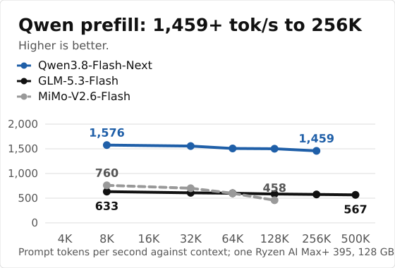
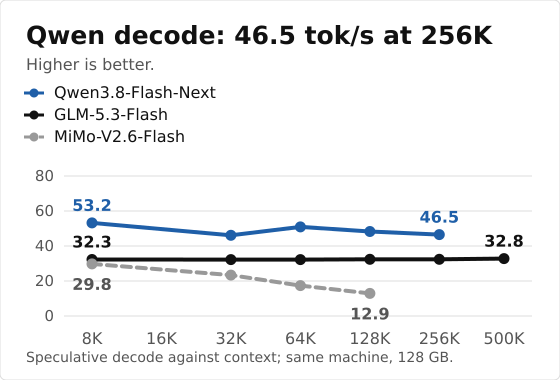

# Strix Halo (AMD)

Kyojin was built for this machine first: one Ryzen AI Max+ 395 with 128 GB of unified memory, ROCm 7, gfx1151. Model list: [models.md](models.md). Install: [install.md](install.md). Kernel notes: [strix-halo.md](strix-halo.md).

<table align="center">
<tr><th align="left">Model</th><th>Pack</th><th>Prefill</th><th>Speculative decode</th></tr>
<tr><td><b>Qwen3.8-Flash-Next</b></td><td align="right">95 GB</td><td align="right">1480 at 8K<sup>1</sup></td><td align="right"><b>47.5 to 73.2</b></td></tr>
<tr><td><b>GLM-5.3-Flash</b></td><td align="right">99.73 GB</td><td align="right">652 at 8K</td><td align="right"><b>27.4 to 36.8</b></td></tr>
<tr><td>MiMo-V2.6-Flash <sub>(1.5)</sub></td><td align="right">105.8 GB</td><td align="right">760 at 8K</td><td align="right">28.9 to 37.0</td></tr>
<tr><td>DeepSeek-V4.1-Flash <sub>(experimental, SSD tier)</sub></td><td align="right">185 GB</td><td align="right">187 to 257 at 8K</td><td align="right">5 to 11 <sub>(plain)</sub></td></tr>
</table>

<p align="center"><sub>Tokens per second on one Ryzen AI Max+ 395 with 128 GB (Radeon 8060S, gfx1151, ROCm). Kyojin 1.5.10, measured 2026-10-17, except the Flash-Next prefill: Kyojin 1.8.9, 2026-11-04. Prefill at the context shown in each cell, speculative decode across chat, prose and code prompts. DeepSeek-V4.1-Flash is larger than memory: most experts are read from the NVMe (about 3 GB/s), so its prefill is warm/cold and its decode is plain decoding on real sessions; a tool turn of about 2K tokens waits 21 to 35 s for the first token. Details: <a href="DS41.md#speed">DS41.md</a>. Method, sources and full tables: <a href="benchmarks.md">benchmarks.md</a>.<br><sup>1</sup> Flash-Next prefill is measured with its 24.4 GiB n-gram table streamed from disk (the default since 1.7.0, saves about 22 GiB of RAM). RAM placement (<code>EXL3_NGRAM_STREAM=0</code>) gives about 1580 and costs those 22 GiB; releases up to 1.6 placed it in RAM automatically, which is where the earlier 1621 came from.</sub></p>

<p align="center">


</p>

<p align="center"><b>Long context: up to 500K tokens</b></p>

<table align="center">
<tr><th align="left">Model</th><th>128K</th><th>256K</th><th>500K</th></tr>
<tr><td><b>Qwen3.8-Flash-Next</b></td><td align="right">1505 / 54.8</td><td align="right">1399 / 46.9</td><td align="right">1224 / 48.1</td></tr>
<tr><td><b>GLM-5.3-Flash</b></td><td align="right">649 / 30.8</td><td align="right">619 / 34.3</td><td align="right">567 / 26.4</td></tr>
</table>

<p align="center"><sub>Prefill / speculative decode, tokens per second, Kyojin 1.5.10 on one Ryzen AI Max+ 395 with 128 GB. One real document read as a growing prompt (500K = 499,712 tokens); prefill as reported by the server. Both models recalled two facts hidden at 40 % and 85 % of a ~500K-token prompt (needle test, Kyojin 1.5.3, 15/10).</sub></p>

500K needs <code>-c 524288</code> at launch. Qwen also needs <code>--cache-bits 8</code>: past 262K it uses the 8-bit cache.

## Quickstart

Install ROCm torch and build once ([install.md](install.md)), then:

```bash
git clone https://github.com/Yamz-Labs/kyojin && cd kyojin
hf download yamz-labs/Qwen3.8-Flash-Next-EXL3-Yamz --local-dir ./qwen-pack
python tools/qwen/serve.py --model ./qwen-pack --port 8000 -c 131072
```

The server speaks the OpenAI API on port 8000. GLM and MiMo commands: [models.md](models.md).

**Memory vs speed (Qwen3.8-Flash-Next).** The 24.4 GiB n-gram table is streamed from disk by default: about 1480 tok/s prefill at 8K and 22 GiB of RAM left free. Add `--ngram-ram` (or set `EXL3_NGRAM_STREAM=0`) to load it into RAM: about 1580 tok/s at 8K, 22 GiB more RAM used. Same switch for any PLE model; results are identical.

## DeepSeek-V4.1-Flash

**Experimental.** A demonstration that a 763B model runs exactly on one 128 GB machine. It is slow and not meant for daily agent use: real decode is about 5 to 11 tokens per second, and a tool turn adding about 2K tokens takes about 20 to 35 seconds before the first token (the SSD floor is about 24 s).

DeepSeek-V4.1-Flash-1017 (763B parameters, about 16B active) runs on one 128 GB machine with an NVMe: the 172 GiB EXL3 pack is larger than memory, so the engine keeps a pool of experts in RAM and reads the others from the SSD, exactly. It uses the model's own DSpark draft stages and the original Engram tables (about 190 GB, downloaded from the DeepSeek repository). Pack: [yamz-labs/DeepSeek-V4.1-Flash-EXL3-Yamz](https://huggingface.co/yamz-labs/DeepSeek-V4.1-Flash-EXL3-Yamz). Setup, SSD tier, Engram and speeds: [DS41.md](DS41.md).

