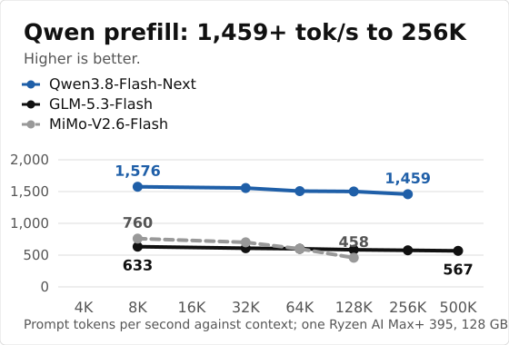
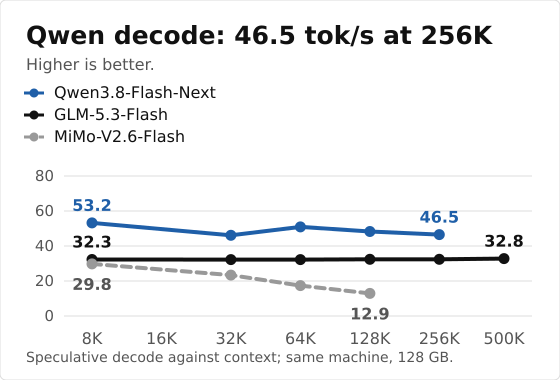

# Strix Halo (AMD)

Kyojin was built for this machine first: one Ryzen AI Max+ 395 with 128 GB of unified memory, ROCm 7, gfx1151. Model list: [models.md](models.md). Install: [install.md](install.md). Kernel notes: [strix-halo.md](strix-halo.md).

{{TABLE}}

<p align="center"><sub>Tokens per second on one Ryzen AI Max+ 395 with 128 GB (Radeon 8060S, gfx1151, ROCm). Kyojin 1.8.10, measured 2026-11-05 (MiMo: Kyojin 1.5.10). Prefill at the context shown in each cell, speculative decode across chat, prose and code prompts. DeepSeek-V4.1-Flash is larger than memory: most experts are read from the NVMe (about 3 GB/s), so its prefill is warm/cold and its decode is plain decoding on real sessions; a tool turn of about 2K tokens waits 21 to 35 s for the first token. Details: <a href="DS41.md#speed">DS41.md</a>. Method, sources and full tables: <a href="benchmarks.md">benchmarks.md</a>.</sub></p>

<p align="center">


</p>

{{LONG}}

## Quickstart

Install ROCm torch and build once ([install.md](install.md)), then:

```bash
git clone https://github.com/Yamz-Labs/kyojin && cd kyojin
hf download yamz-labs/Qwen3.8-Flash-Next-EXL3-Yamz --local-dir ./qwen-pack
python tools/qwen/serve.py --model ./qwen-pack --port 8000 -c 131072
```

The server speaks the OpenAI API on port 8000. GLM and MiMo commands: [models.md](models.md).

**Memory vs speed (Qwen3.8-Flash-Next).** The 24.4 GiB n-gram table is streamed from disk by default: 22 GiB of RAM stay free (the 8K figures above use this default). Add `--ngram-ram` (or set `EXL3_NGRAM_STREAM=0`) to load it into RAM: slightly faster prefill, 22 GiB more RAM used. Same switch for any PLE model; results are identical.

## DeepSeek-V4.1-Flash

**Experimental.** A demonstration that a 763B model runs exactly on one 128 GB machine. It is slow and not meant for daily agent use: real decode is about 5 to 11 tokens per second, and a tool turn adding about 2K tokens takes about 20 to 35 seconds before the first token (the SSD floor is about 24 s).

DeepSeek-V4.1-Flash-1017 (763B parameters, about 16B active) runs on one 128 GB machine with an NVMe: the 172 GiB EXL3 pack is larger than memory, so the engine keeps a pool of experts in RAM and reads the others from the SSD, exactly. It uses the model's own DSpark draft stages and the original Engram tables (about 190 GB, downloaded from the DeepSeek repository). Pack: [yamz-labs/DeepSeek-V4.1-Flash-EXL3-Yamz](https://huggingface.co/yamz-labs/DeepSeek-V4.1-Flash-EXL3-Yamz). Setup, SSD tier, Engram and speeds: [DS41.md](DS41.md).

